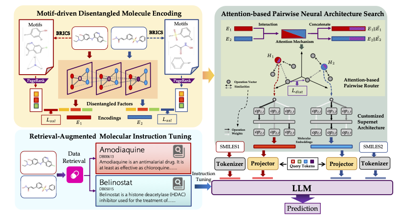

# DyNAS-DDI
Code implementation for DyNAS-DDI: Dynamic Pairwise Architecture Search for Generalizable Drug-Drug Interaction LLM, accepted by ACM MM 2025. Our paper is available at [Paper](https://dl.acm.org/doi/epdf/10.1145/3746027.3755791).



The project is organized around `main.py` (entry point), `model/` (DyNAS and model components), `datamodule/` (dataset loading and collation), and `processor/` (raw-to-training-data conversion scripts).

## 1. Environment Setup

Create the conda environment:

```bash
conda env create -f environment.yml
conda activate DyNAS
```

Then check `environment.yml` for any commented optional dependencies and install as needed.

Important dependency notes:
- Install `pytorch` according to your CUDA version from the official PyTorch guide.
- Install `pytorch_geometric` using the official installation matrix.
- `autogllight` code is vendored in this repository (`autogllight/`), so no separate pip package is required for the local code path.

https://drive.google.com/drive/folders/1fO3ai7OuB5TskmdvslZDjFj1ZalIMEAc?usp=sharing

## 2. External Resources

This code expects several local resource directories. Some may need to be downloaded from [Link](https://drive.google.com/drive/folders/1fO3ai7OuB5TskmdvslZDjFj1ZalIMEAc?usp=drive_link). The backbone Galactica-1.3B model should be put into `modelscope/`.

If you do not want local files, you can switch `--opt_model` to a supported remote model id (for example `facebook/galactica-1.3b`) and rely on online model download.

## 3. Data Preparation

This project expects processed datasets in a folder structure like:

```text
../OOD/ChChMiner_scaffold/
  train/
    graph1/<idx>/graph_data.pt
    graph2/<idx>/graph_data.pt
    smiles1/<idx>/text.txt
    smiles2/<idx>/text.txt
    text/<idx>/text.txt
    property1/<idx>/text.txt
    property2/<idx>/text.txt
  valid/
  test/
```

You can use `processor/DDI.py` for `ChChMiner, DeepDDI, ZhangDDI` datasets and `processor/drugbank.py` for `Drugbank` dataset. They read CSVs under `../../OOD/` and write processed split folders under `../../OOD/<dataset_name>/`. Raw files can also be downloaded in [Link](https://drive.google.com/drive/folders/1fO3ai7OuB5TskmdvslZDjFj1ZalIMEAc?usp=drive_link).

Note: these scripts expect raw files such as `../../OOD/ChChMiner_scaffold_train.csv` / `_valid.csv` / `_test.csv` (or DrugBank equivalents) to already exist.

## 4. Running the code

Use the provided scripts:

```bash
bash pretrain.sh
bash finetune.sh
```
for `ChChMiner_scaffold` dataset as an example. Both scripts also include commented blocks for `Drugbank_scaffold`.

Or you can run `main.py` directly without shell scripts.

